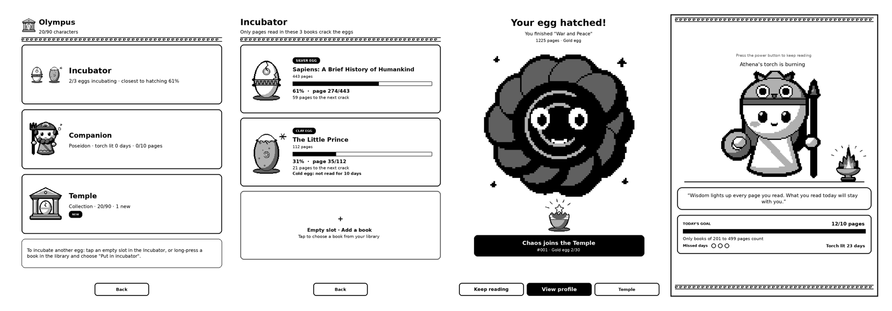
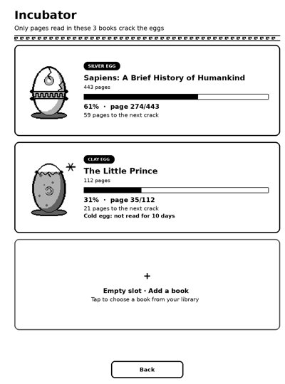
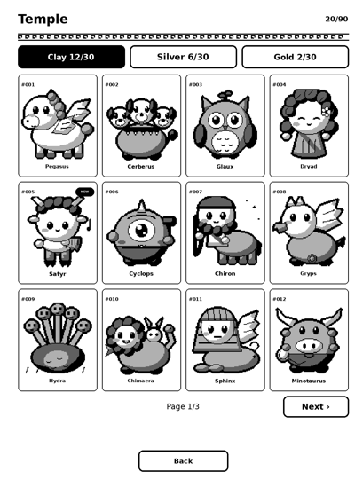
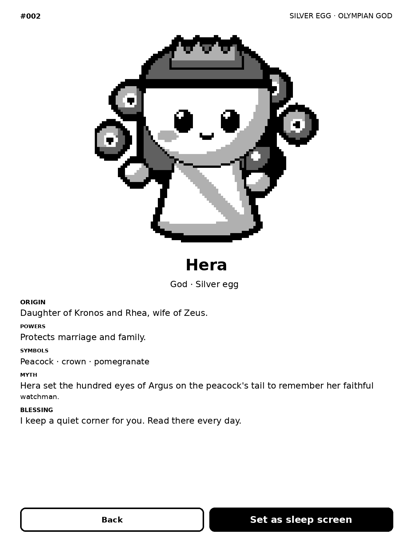
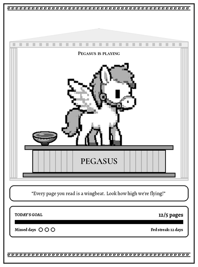

# Olympus: a reading game for e-readers

**Finish a book, hatch a legend.**

Olympus turns reading into a collection game: every book you finish hatches a Greek-myth character on your e-reader, and reading every day keeps your favorite one by your side on the sleep screen.

## How it works

- **Incubator.** Put up to three books in the incubator. The thicker the book, the rarer the egg: clay (0–200 pages), silver (201–499) or gold (500+).
- **Hatching.** The egg follows your reading position and cracks as you go. At 95% of the book it hatches.
- **Temple.** 90 hand-drawn pixel characters: 30 creatures, 30 Olympian gods, 30 Titans and primordials. No duplicates, and every character has a profile with origin, powers, symbols and myth.
- **Companion.** Set any hatched character as your sleep screen. Read 5, 10 or 20 pages a day (by tier) to keep a creature fed or a god's torch burning. Miss three days in a row and your creature goes back to the Temple, or the torch burns down to embers.

No ads, no accounts, no network. Everything stays on your device.

| | | | |
|---|---|---|---|
|  |  |  |  |
| Incubator | Temple | Character profile | Sleep screen: creature |

## Download

Get the latest files from the [Releases page](../../releases/latest).

| Device | What you need | Guide |
|---|---|---|
| Kindle (and other devices running KOReader) | `olympus.koplugin.zip` | [Installation](docs/Olympus-Kindle-Installation-Guide.pdf) · [User guide](docs/Olympus-Kindle-User-Guide.pdf) |
| Xteink X4 Pro | Olympus firmware built on CrossPoint | Coming soon |

## Install on KOReader (short version)

1. Unzip `olympus.koplugin.zip` and copy the whole `olympus.koplugin` folder into `koreader/plugins/` on your device.
2. Restart KOReader.
3. Long-press the top-right corner of the screen, or open menu → Tools → Olympus.

The full guide with screenshots is in [docs/](docs/).

## Good to know

- Only books opened in **KOReader** count. DRM-protected Amazon books can't be opened in KOReader, and pages read in the Kindle's built-in reader don't count. DRM-free EPUB, PDF, MOBI, AZW3 and FB2 all work.
- On Kindles with ads (Special Offers), KOReader can't replace the sleep screen. The rest of the game works.
- Languages: English and Vietnamese. Olympus follows KOReader's language, or choose in menu → Tools → Olympus → Language.
- Status: the game rules are covered by automated tests and the layouts are checked at 600×800 and 1072×1448. It has not been tested on many real devices yet, so please report what you find.

## Feedback

Found a bug or have an idea? [Open an issue](../../issues). If KOReader crashes, attach `koreader/crash.log`.

## License

Olympus is free software under the [GNU AGPL-3.0](LICENSE), the same license as KOReader.

## Tiếng Việt

Olympus có đầy đủ giao diện tiếng Việt. Hướng dẫn: [cài đặt](docs/Huong-dan-cai-dat-Olympus-Kindle.pdf) · [sử dụng](docs/Huong-dan-su-dung-Olympus-Kindle.pdf).
